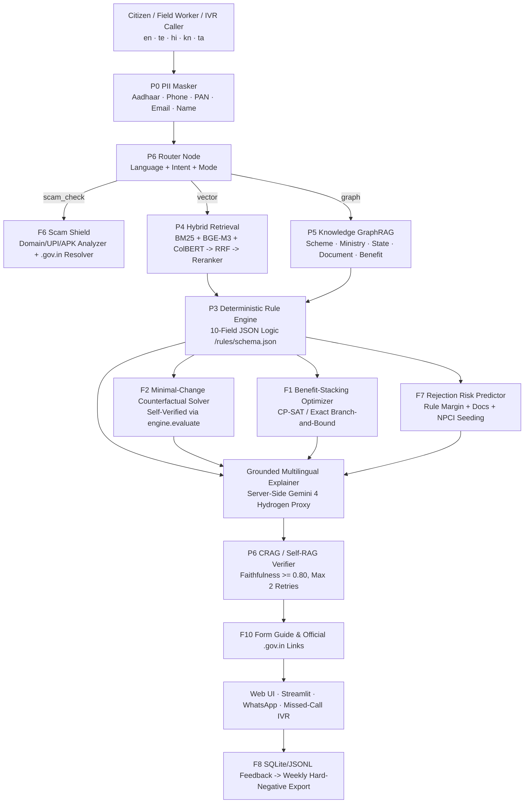

# Yojana Mitra — Neurosymbolic System Architecture

## 1. Core Architectural Principle
**Deterministic Rules Decide. LLMs Explain.**
Every eligibility verdict (`ELIGIBLE`, `NOT_ELIGIBLE`, `NEEDS_INFO`), counterfactual boundary edit, and mutual-exclusion benefit stack is computed strictly by symbolic engines (`/rules/engine.py`, `/rules/counterfactual.py`, `/rules/optimizer.py` and mirrored in `src/lib/engine.ts`). Hosted LLMs (`gemini-4-hydrogen` via server-side proxy) are restricted strictly to multilingual synthesis, document transcription, and accessible explanation grounded on verified rule traces.

## 2. End-to-End Neurosymbolic Flow (Mermaid)

## 3. Privacy & Security Boundaries (DPDP Act 2023)
1. **Ingress Redaction**: All text inputs pass through `mask_pii()` before any trace span, log write, or LLM API call.
2. **Zero Aadhaar Persistence**: Keys containing `aadhaar`/`aadhar` are stripped on ingress and never stored in SQLite or JSONL logs.
3. **Ephemeral Document Processing**: Uploaded certificates in F3 Document Scan are processed strictly in memory and discarded immediately after structured field extraction.
4. **Server-Side API Isolation**: `GEMINI_API_KEY` stays strictly on the Express/FastAPI server; client bundles never access API keys or import `@google/genai`.
